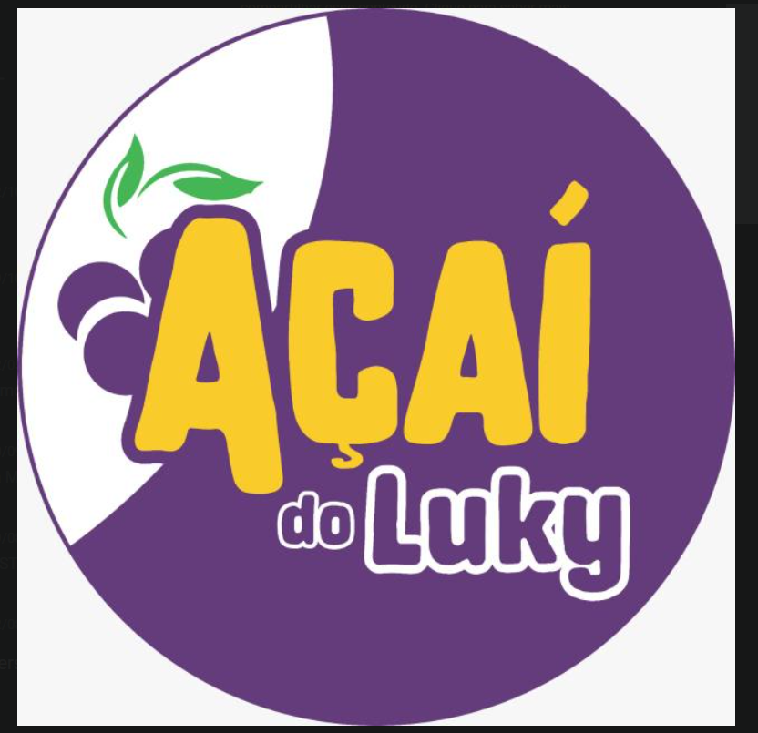

<div align="center">

  

  # 🍇 Açaí do Luky
  ### Plataforma Full-Stack de Delivery & Gestão em Tempo Real

  <p align="center">
    Um ecossistema completo e independente criado sob medida para delivery de açaí, eliminando taxas de marketplaces (como iFood), retendo 100% da base de clientes e proporcionando uma experiência de compra ágil, moderna e segura.
  </p>

  <p align="center">
    <a href="https://acai-do-luky.vercel.app/" target="_blank">
      
    </a>
  </p>

  <p align="center">
    
    
    
    
    
    
    
    
  </p>

</div>

---

## 🔗 Links Oficiais em Produção

| Aplicação | Link de Acesso | Descrição |
| :--- | :--- | :--- |
| 🛒 **Cardápio do Cliente** | [https://acai-do-luky.vercel.app/](https://acai-do-luky.vercel.app/) | Loja virtual dos clientes para montar copos e fazer pedidos. |
| 🔐 **Painel Administrativo** | [https://acai-do-luky.vercel.app/admin](https://acai-do-luky.vercel.app/admin) | KDS de cozinha, estoque, faturamento, promoções e configurações. |

---

## 🌟 Funcionalidades em Destaque

### 🛍️ Para o Cliente (Mobile-First Experience)
* 🥣 **Montador de Copo em 4 Passos:**
  * Escolha de tamanhos (300ml, 500ml, 700ml e Barca 1 Litro);
  * Seleção de bases (Tradicional, Trufado, Banana, Cupuaçu, etc.);
  * Seleção de acompanhamentos grátis com limitador inteligente;
  * Adicionais especiais calculados em tempo real (Nutella, KitKat, Morango fresco);
  * Caldas irresistíveis e campo de observações especiais.
* 🌓 **Modo Escuro & Claro (Dark Mode):** Alternância instantânea com tema dark profundo, sem falhas de contraste e persistido no navegador.
* 📦 **Rastreamento de Pedido:** Timeline ao vivo (*Recebido ➔ Preparo ➔ Saiu p/ Entrega ➔ Concluído*).
* 💳 **Checkout Multiformas:**
  * **Pix:** chave copia-e-cola com valor exato formatado;
  * **Cartão:** escolha de Débito ou Crédito na entrega;
  * **Dinheiro:** calculadora automática de troco.
* 🚨 **Aviso de Loja Fechada:** Se o lojista pausar o atendimento, um alerta em tempo real é disparado e as compras são bloqueadas amigavelmente.

---

### 👨‍🍳 Para o Lojista (Painel Administrativo / KDS)
* 🔔 **Campainha Sonora de Pedidos:** Alerta sonoro agradável via Web Audio API quando um novo pedido entra na cozinha.
* ⚡ **Sincronização em Tempo Real (Supabase Realtime):** Pedidos e status atualizados instantaneamente sem necessidade de recarregar a página.
* 🔴 **Abertura / Fechamento em 1 Clique:** Botão direto no cabeçalho do painel para abrir ou pausar o cardápio no mesmo segundo.
* ⏳ **Promoções Temporárias com Horas:** Defina descontos (ex: 15% OFF) com cronômetro de expiração automática (24h, 48h, etc.).
* 📦 **Controle de Estoque:** Gestão de ingredientes e embalagens com alertas automáticos de estoque baixo.
* 🖨️ **Impressão Térmica de Comandas:** Compatível com impressoras de 58mm e 80mm (Bluetooth/USB) para cozinha e motoboy.
* 🛡️ **Segurança em Camadas (RLS + 2FA):**
  * Proteção no banco via **Row Level Security (RLS)** do PostgreSQL;
  * Autenticação em 2 Etapas (2FA) via WhatsApp para autorizar novos aparelhos;
  * Memorização de dispositivos confiáveis via token seguro.

---

## 🛠️ Tecnologias Utilizadas

```
Frontend:
├── React 19 + TypeScript
├── Vite 8 (Build ultrarrápido)
├── Tailwind CSS v4 (Design moderno & Dark Mode)
├── Lucide React (Ícones consistentes)
└── Supabase JS Client v2 (Realtime & RPCs)

Backend / Nuvem:
├── Supabase (PostgreSQL 15 + Row Level Security + Realtime)
├── Node.js + Express + Socket.IO (Opção de servidor local)
└── Vercel (Edge Deployment com CI/CD contínuo)
```

---

## 🚀 Como Executar o Projeto Localmente

### Pré-requisitos
* [Node.js](https://nodejs.org/) (versão 18 ou superior)
* [Git](https://git-scm.com/)

### 1. Clonar o Repositório
```bash
git clone https://github.com/messiaswwx/Acai-do-Luky.git
cd "Acai-do-Luky"
```

### 2. Configurar Variáveis de Ambiente
Crie um arquivo `.env` dentro da pasta `client/` com suas chaves do Supabase:
```env
VITE_SUPABASE_URL=https://sua-url.supabase.co
VITE_SUPABASE_ANON_KEY=sua-chave-anon-publica
```

### 3. Instalar Dependências e Iniciar
```bash
# Instalar dependências do frontend
npm --prefix client install

# Rodar o frontend em modo desenvolvimento
npm --prefix client run dev
```

Acesse no seu navegador: [http://localhost:5173](http://localhost:5173)

---

## 🔒 Segurança & Banco de Dados

O banco de dados foi projetado no **PostgreSQL (Supabase)** com políticas estritas de **Row Level Security (RLS)**:

* 🔐 **Tabela `admin_auth_secrets`**: Mantém o PIN do administrador e o código mestre 2FA protegidos contra qualquer leitura pública.
* 🛡️ **Stored Procedures (`SECURITY DEFINER`)**: Operações críticas de login, 2FA e alteração de dados de pagamento (Pix) rodam como funções no banco, impedindo injeções ou adulterações via API pública.
* 🧼 **Sanitização de Entradas**: Proteção contra XSS e injeções nos campos de checkout.

---

## 📄 Licença

Este projeto é desenvolvido sob a licença [MIT](LICENSE).

<div align="center">
  <sub>Feito com 💜 para o <strong>Açaí do Luky</strong></sub>
</div>
